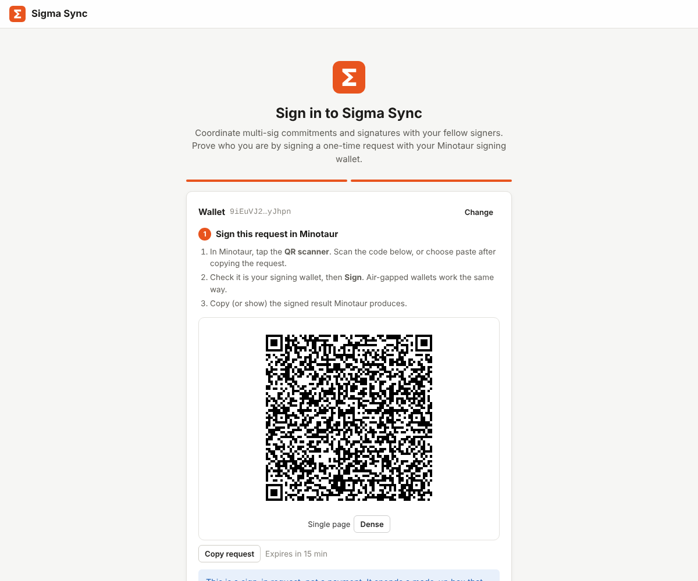
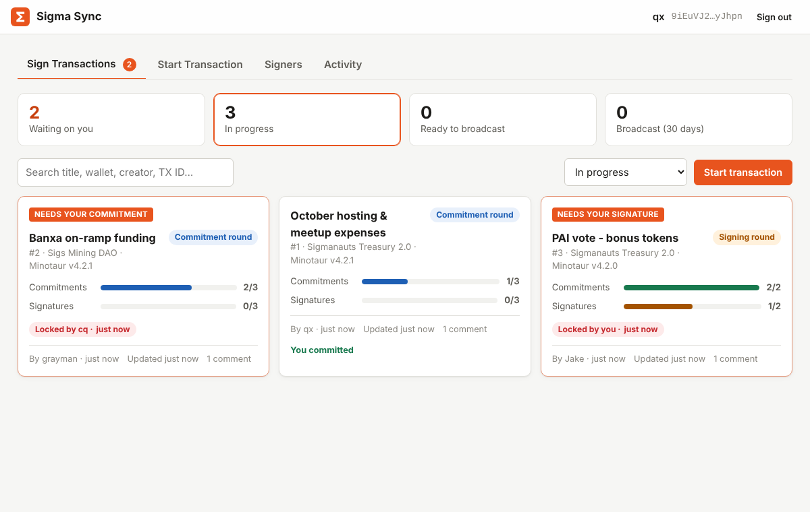
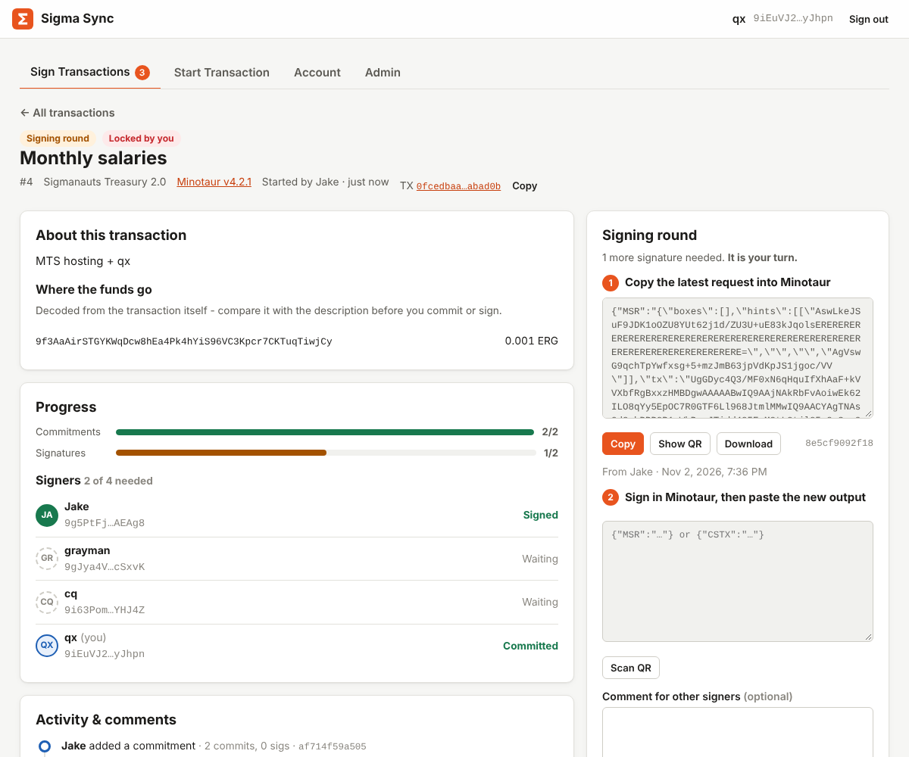

# Sigma Sync

Coordinate Ergo multi-signature transactions with your fellow signers.

[Minotaur](https://github.com/minotaur-ergo/minotaur-wallet) multi-sig works in two rounds: every signer adds a
**commitment**, then every signer adds a **signature**, each time continuing from the
latest request. Passing those requests around a spreadsheet or a chat breaks easily: someone
continues from an old copy and erases another signer's commitment, two people work at the same time,
a paste picks up a stray line break, and nobody is sure whose turn it is.

Sigma Sync is a small web app that keeps one source of truth for each transaction:

- **Wallet sign-in, no passwords, no sign-up.** Anyone proves who they are by signing a one-time
  request with their Minotaur signing wallet (QR code for air-gapped wallets, or copy/paste).
- **You only see your own transactions.** Every multi-sig request lists the public keys of its
  signers. A transaction is visible only to accounts holding one of those keys, so access follows
  the wallet itself, not a list someone maintains.
- **One signer at a time.** Lock a transaction, copy the latest request into Minotaur, paste your
  output back. Submitting releases the lock. If someone walks away, two other signers can vote to
  force-unlock it.
- **Every paste is checked.** It must be the same Ergo transaction, keep every earlier
  commitment and signature, and add yours. A stale or wrong paste is refused with an explanation.
- **Clear progress.** Cards show commitments and signatures against the M-of-N threshold, who
  holds the lock, and what is waiting on you. Each signer key shows whether its owner has
  committed or signed. Each transaction has a description, comments,
  and a full activity history.
- **Review before you sign.** A *Transaction details* panel decodes the transaction itself: every
  payment with its ERG and tokens (names and decimals from the explorer) and destination, the
  fee, the change, and which wallet addresses it spends from, with a warning when it spends from
  more than one. It ends with a reminder to verify everything again in Minotaur.
- **Minotaur generation check.** Minotaur 3.0+ and 2.x write different request layouts and cannot
  read each other's. Sigma Sync detects the layout (it cannot tell 3.0 from 4.2.1 - those are
  identical) and refuses a paste from the wrong generation for the transaction's chosen version.
- **QR codes both ways.** Requests are shown as paged/animated QR codes in Minotaur's own
  format, and the camera scanner reads Minotaur's paged QR codes back.
- **Encrypted at rest.** Titles, descriptions, payloads and comments are stored with AES-256-GCM.

| Sign in | Transactions | Your turn |
|---|---|---|
|  |  |  |

## How it works

### Sign-in

1. Enter the address of your **signing wallet** (the regular wallet you sign multi-sig with,
   not the multi-sig wallet).
2. Sigma Sync builds a Minotaur *cold signing request* (`{"CSR": ...}`) that spends a box
   owned by that address. The box is **made up**: it does not exist on the blockchain, and its
   ID is derived from a random one-time challenge. The signed result can never be broadcast,
   so no funds can move.
3. Sign it in Minotaur (scan the QR code or paste), then paste or scan the signed result
   (`{"CSTX": ...}`) back.
4. The server checks the signed transaction is exactly the one it issued and verifies the
   Schnorr signature against the address's public key (pure Perl: Blake2b-256, secp256k1 and
   the Ergo Fiat-Shamir proof format; see [`ErgoKit.pm`](ErgoKit.pm)). The first sign-in creates
   an account; you then pick the name your co-signers see.

#### Sign-in with Nautilus

When the env file sets `SITE_HOST`, the server also accepts a sign-in from the Nautilus browser
wallet, for a new account and for linking an address:

1. `auth_start` with `method=nautilus` returns a one-time challenge (64 hex characters) and no
   Minotaur request.
2. Nautilus's `auth(address, challenge)` signs the text `challenge;host;seconds;random` and
   returns the text and its proof.
3. `auth_finish` checks that the stored challenge was issued for Nautilus and for this address,
   that the host in the text is `SITE_HOST`, that the time is no more than 5 minutes outside the
   challenge's life, and verifies the proof with the same Schnorr code. From there it continues
   exactly as the Minotaur sign-in.

Each challenge stores its method, so an answer made for one method is refused for the other.
Without `SITE_HOST` the server refuses the Nautilus method.

### Who sees what

- When a transaction is started, Sigma Sync reads the signer public keys out of the transaction
  (the `atLeast(M, keys)` proposition of each input) and stores them with it.
- An account sees, locks, signs, comments on or cancels a transaction **only if one of its proven
  addresses is one of those keys**. Anyone else gets "Transaction not found". Admins are no exception.
- Only a signer of the wallet can start a transaction for it. The request may already carry
  commitments (yours or another signer's); anyone whose key has not committed adds theirs in turn.
- Minotaur derives each multi-sig key from every signer's wallet at the same address index, so a
  multi-sig's first address uses each signer's first address. If you sign with several wallets,
  or a multi-sig uses a later address, link those addresses on the **Account** tab (each one is
  proven with its own signature).
- Signers who have not signed in yet are listed as "Not on Sigma Sync yet"; the transaction appears
  for them the moment they do.

Admins (from `ADMIN_ADDRESSES`, or promoted by another admin) can disable accounts and read the
audit log. That is all.

### Rounds and statuses

| Status | Meaning |
|---|---|
| Commitment round | Signers add commitments until M are in |
| Signing round | Signers who committed add signatures until M are in |
| Ready to broadcast | The final payload is complete; publish it from Minotaur |
| Broadcast | Someone confirmed it was published (the page also checks the explorer) |
| Cancelled | The creator or an admin stopped it, with a reason |

M (signatures required) and N (keys in the wallet) are read from the first request, as is the
final Ergo transaction ID, so the explorer link works from the start.

### Checks on every paste

| Problem | What happens |
|---|---|
| Line breaks, zero-width characters, smart quotes, BOM | Removed automatically; nothing else is changed |
| Truncated or invalid JSON | Refused ("it may be cut off") |
| A different Ergo transaction | Refused |
| A commitment or signature from an earlier paste is missing or replaced | Refused ("you probably started from an older request") |
| Nothing new added (the request pasted back) | Refused |
| One page of a multi-page QR code | Refused, with a hint to scan every page |
| A commitment or signature for someone else's key | Refused: each signer submits their own |
| A new commitment after signing has started | Refused: commitments are closed |

Each stored payload has a short SHA-256 fingerprint so signers can tell versions apart.

### Your step is final

Once your commitment (or signature) is in, the next signers build on it, so it cannot be redone.
You can only lock a transaction while it still needs **your** step: in the commitment round if
none of your keys has committed, in the signing round if you committed and have not signed.
Signers who did not commit cannot join once signing has started.

### Batches

**Start Batch** takes tens of requests at once - pasted one after another, as a JSON array, or
uploaded as `.json`/`.txt` files. Each may be an unsigned cold signing request (`{"CSR":…}`,
nobody committed yet) or a multi-sig request (`{"MSR":…}`), with or without commitments already in it.

1. **Check** reads every entry and shows what it sends, its M-of-N wallet and its Ergo TX ID,
   and flags duplicates, transactions already tracked, and wallets you do not sign for. Nothing
   is written.
   It also checks how the entries relate on-chain: two entries spending the same box (or a box an
   open transaction already spends) can never both confirm, so the later one is flagged; an entry
   that spends another entry's output is marked "after entry N".
2. **Start** creates one transaction per valid entry, named `<batch name> 1`, `<batch name> 2`, …
   **in broadcast order** (an entry always comes after the ones it spends from), sharing the
   wallet name, Minotaur version, description and note. Chained transactions get a comment saying
   which one must be broadcast first.
3. Signers work through them as usual; after each submit, **Next in batch** jumps to the next one
   waiting for them.

For a transaction started from a CSR, the first committer opens it with Minotaur's
**home-screen** scanner (or paste there): Minotaur files it under the multi-sig wallet, where they
press Commit. Everyone after that uses the multi-sig wallet's Multi-sig Communication page.

### Locks

Only the lock holder sees the latest request and can submit. Submitting or releasing frees
the lock. If a lock is abandoned, `UNLOCK_VOTES` other signers (default 2) can vote to force it
open, at different times, once it has been held for `UNLOCK_GRACE_MINUTES` (default 10).

## Stack

Perl CGI + MariaDB + vanilla HTML/CSS/JS, no build step. Two small libraries are vendored in
[`vendor/`](vendor/README.md) (QR generation and a QR decoder fallback).

| File | Purpose |
|---|---|
| `api.pl` | All API actions (`action=...`, POST only) |
| `ErgoKit.pm` | Ergo addresses, sign-in request/verification, payload analysis |
| `AppConfig.pm` | Config file, database connection, encryption at rest |
| `app.js`, `index.html`, `style.css` | The single-page frontend |
| `schema.sql` | Database schema |
| `deploy/sigmasync.conf` | Apache include (CSP and security headers, access rules) |
| `redeploy.sh` | Re-applies ownership, permissions and SELinux labels after a pull |
| `DEPLOY.md` | Server setup, verification gates, troubleshooting |
| `App_Summary.md` | Security and data summary for auditors |

## Development

Requirements: Perl with `CGI`, `DBI`, `DBD::mysql`, `CryptX` (and ideally `Math::BigInt::GMP`),
plus MariaDB.

```bash
mysql -u root < schema.sql            # then create a user as shown at the end of schema.sql
cp sigmasync.env.example dev.env      # fill in DB_*, DATA_KEY, ADMIN_ADDRESSES;
                                      # set COOKIE_SECURE=0 and COOKIE_PATH=/ for local HTTP,
                                      # and SITE_HOST=127.0.0.1:8080 for Nautilus sign-in
APP_ENV_FILE=$PWD/dev.env python3 tools/dev-server.py 8080
prove -I. t/                          # unit tests
```

The sign-in fixture in `t/fixtures/login.json` was signed with a throwaway key by sigma-rust
(`ergo-lib`), so the tests check the Perl verifier against the reference implementation.

## Deployment

See [DEPLOY.md](DEPLOY.md). In short: create the database and user, write
`/data/AAP_Storage/secrets/sigmasync.env`, install `deploy/sigmasync.conf`, add the one-time
SELinux rules, then run `sudo ./redeploy.sh` after every pull.
